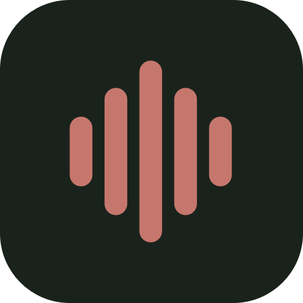

<p align="center"><a href="https://suhaasbadada.github.io/handsfree/"></a></p>

# HandsFree · BETA

**Don’t lose your train of thought.**

Say it while it’s clear. HandsFree turns your thoughts into text, without making typing the bottleneck.

[](LICENSE)
[](https://github.com/suhaasbadada/handsfree/releases/tag/v0.1.1-beta.13)
[](#platforms)

## Download & install

### Mac — Homebrew recommended

**Apple Silicon Mac · macOS 14+ · English.** Open Terminal and paste (if needed, [install Homebrew first](https://brew.sh/)):

```sh
brew install --cask suhaasbadada/handsfree/handsfree
```

Homebrew simplifies installation; macOS security prompts may still appear. This beta is self-signed, not notarized. If Homebrew 7 reports an untrusted cask, review the [tap repository](https://github.com/suhaasbadada/homebrew-handsfree#readme). Only if you trust its code, run `brew trust --cask suhaasbadada/handsfree/handsfree`, then retry the install. Cask trust is not Apple approval.

Open **Applications → HandsFree**, allow Microphone, Accessibility, and Input Monitoring, then download the English model (~148 MB) in Settings → Overview. [Complete Mac setup, security prompts & existing-app guidance](docs/INSTALL.md).

### [Download for Mac (.dmg)](https://github.com/suhaasbadada/handsfree/releases/download/v0.1.1-beta.13/HandsFree-0.1.1-beta.13-macos-arm64.dmg)

**DMG alternative:** drag HandsFree to Applications before opening it or granting permissions. Intel Macs are unsupported. See [Open Anyway and installation guidance](docs/INSTALL.md). No developer tools needed.

[Website](https://suhaasbadada.github.io/handsfree/) · [Releases](https://github.com/suhaasbadada/handsfree/releases) · [Report a bug](https://github.com/suhaasbadada/handsfree/issues)

HandsFree is an open-source, local-first dictation companion. Tap a shortcut, speak, and get text in the field you started in. No account, paid API, telemetry, or cloud transcription service.
Current product and development focus is **Mac-only: Apple Silicon, macOS 14+**. Windows work is paused; Linux is not supported. There are no commitments or release dates for either port.

## Features

- **Private by design:** Whisper runs locally with Apple Silicon Metal. Download the model once; dictate offline afterward.
- **Stay in flow:** a compact recording capsule, live mic meter, and Escape to cancel.
- **Try your voice:** explicit-button [practice in Overview](docs/practice.md), with a temporary editable result and no paste, clipboard changes or usage tracking. This tests capture and transcription, not shortcuts or external insertion.
- **Your shortcut:** Fn / 🌐 or a custom key combination. Toggle is the default; opt into **Settings → Recording mode → Push to talk** to hold and release. Existing saved shortcuts are preserved.
- **Practical controls:** optional listening sounds and local usage totals. Dictation text stays out of the app window.
- **Safer insertion:** checks the original app and field before submitting Paste; otherwise copies for manual paste.
  Mac users can opt into **Settings → Compatibility paste** for apps that hide their text field. It requires the same verified active app/window, but cannot verify the exact field. It is off by default, including upgrades; missing window proof or focus monitoring still requires manual paste. A submitted shortcut does not confirm insertion; no automatic retry or Enter is sent. See [delivery safeguards and limits](docs/COMPATIBILITY-PASTE.md).
- **Explicit signed updates (beta 7 onward):** footer **Updates → Check for updates**, then confirm **Download & restart…** when offered. No startup checks or automatic downloads. [Privacy, safeguards and acceptance limits](docs/UPDATES.md).

## Use cases

- **Think out loud with your coding assistant:** give Claude Code or Codex the goal, context, and details in your own words.
- **Messages & email:** say the reply you have in mind. Review it, then send.
- **Notes & ideas:** capture a thought while it’s fresh; organize it afterward.
- **First drafts:** talk through the rough version, then edit.

No special integration is required: insertion depends on the focused field, with clipboard fallback for terminals and other custom editors. HandsFree doesn’t run commands.

## Platforms

| Platform | Status |
| --- | --- |
| macOS 14+, Apple Silicon | [Mac beta 13 available](https://github.com/suhaasbadada/handsfree/releases/tag/v0.1.1-beta.13) · self-signed, not notarized |
| Intel Macs | Unsupported |
| Windows | Paused; historical experimental implementation, not currently supported |
| Linux | Not supported; no build or download available |

The Tauri 2, Rust, TypeScript and Swift stack retains shared application code and a platform facade for possible future ports, not a promise of cross-platform support. [Historical Windows implementation records](docs/WINDOWS.md) remain available; published release history is unchanged.

## Install

### Mac

1. Install using the recommended Homebrew command above. Alternatively, open the DMG and drag **HandsFree.app to Applications**, then eject the disk image. Launch the Applications copy before granting permissions.
2. If macOS blocks this unnotarized beta, only if you trust the download, use **System Settings → Privacy & Security → Open Anyway**. Respect your organization’s policies; a local signature is not Apple approval.
3. In HandsFree Settings, allow **Microphone**, then enable **Accessibility** and **Input Monitoring** in System Settings. Quit and reopen after changing permissions.
4. Click **Download** for the English Whisper model (~148 MB from Hugging Face, checksum verified). This explicit, one-time setup needs internet; dictation works offline afterward.

Focus a text field, briefly tap **Fn / 🌐**, speak, and tap again to finish. **Escape** cancels. Choose a different shortcut in Settings if Fn conflicts with macOS or your keyboard. If insertion is unavailable, paste the copied transcript yourself. **Review important text:** speech recognition can make mistakes.

**Optional push to talk:** choose **Settings → Recording mode → Push to talk**. Hold Fn or your custom combination; release to finish (the first required component released finishes a combination). Other keys, mouse actions during a hold, or observed focus changes cancel without paste. Toggle remains the default; updates preserve your preferences, model and statistics. See [behavior, focus limits and test notes](docs/PUSH-TO-TALK.md).

[Full installation and troubleshooting guide](docs/INSTALL.md) · [Beta release notes](docs/releases/v0.1.1-beta.13.md)

**Updates (beta 7 onward):** choose footer **Updates → Check for updates**, then
confirm **Download & restart…** when a newer version is offered. Opening the
dialog is local; explicit checks share ordinary connection metadata with GitHub,
never audio, transcripts, settings or usage. Forward OTA replacement/restart has
not yet been verified. Beta 11 publication does not establish that acceptance;
the owner upgrades through the app, not a manual replacement. See the release
notes and the historical [beta 9 repair/bootstrap evidence](docs/releases/v0.1.1-beta.9.md).

**Optional manual Homebrew updates, or beta 6-and-earlier bootstrap:** quit HandsFree, run the following in Terminal, then reopen from Applications:

```sh
brew update
brew upgrade --cask suhaasbadada/handsfree/handsfree
```

Updates preserve your model, settings and statistics. Compatibility paste stays off
unless you enable it in Settings.

## Build from source

The current development target requires Apple Silicon, macOS 14+, Node 22.18+ (24 recommended), Rust stable, CMake, and Xcode Command Line Tools with Swift and a macOS SDK. Keep shared logic behind the existing platform facade; Windows implementation records are historical, not an active development or release track.

```sh
git clone https://github.com/suhaasbadada/handsfree.git
cd handsfree
npm ci
npm run tauri build -- --bundles app
```

The default build is **ad-hoc signed**, not notarized. Rebuilds can require renewed macOS permissions. For installed local updates, use `npm run build:local` with your existing signing identity; see [stable local signing and development](docs/DEVELOPMENT.md). Nothing installs automatically.

```sh
npm test       # automated checks
npm run build  # frontend typecheck and production build
```

## Contributing & support

Bug reports, documentation improvements, and focused contributions are welcome. Read [CONTRIBUTING.md](CONTRIBUTING.md) to get started; include your OS version, CPU architecture, app version, and affected editor in bug reports, never private recordings or transcripts.

- [Security policy](SECURITY.md) — report vulnerabilities responsibly.
- [Development, privacy & diagnostics](docs/DEVELOPMENT.md) — local settings/usage persist; audio recordings and transcript history do not. Clipboard managers may retain copied text.
- [Website development](docs/WEBSITE.md) · [Release packaging](docs/RELEASING.md)

## License

HandsFree’s own code is [MIT licensed](LICENSE), © 2026 Suhaas Badada. Dependencies and speech models retain their own licenses. See [third-party notices and release caveats](docs/RELEASING.md) for upstream licensing details.
