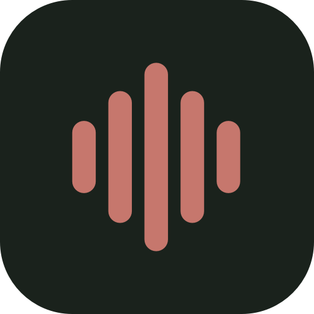

<p align="center"><a href="https://suhaasbadada.github.io/handsfree/"></a></p>

# HandsFree

**Don’t lose your train of thought.**

Local-first dictation for your Mac. Tap a shortcut, speak, and put text in the field you started in.

[](LICENSE)
[](https://github.com/suhaasbadada/handsfree/releases/tag/v0.1.1)

[Website](https://suhaasbadada.github.io/handsfree/) · [Release notes](docs/releases/v0.1.1.md) · [Report a bug](https://github.com/suhaasbadada/handsfree/issues)

## Download & install

**Apple Silicon Mac · macOS 14+ · English.** Mac-only: Intel Macs and Linux are unsupported; Windows development is paused.

**Homebrew recommended** ([install Homebrew](https://brew.sh/) if needed):

```sh
brew install --cask suhaasbadada/handsfree/handsfree
```

Or [Download for Mac (.dmg)](https://github.com/suhaasbadada/handsfree/releases/download/v0.1.1/HandsFree-0.1.1-macos-arm64.dmg), then drag HandsFree to Applications before opening.

**Self-signed, not Apple notarized.** macOS security prompts still apply. If Homebrew requests cask trust, review the [tap repository](https://github.com/suhaasbadada/homebrew-handsfree#readme) first; cask trust is not Apple approval. Follow the [installation guide](docs/INSTALL.md) for security prompts, permissions, existing-app conflicts and older-beta upgrades. Never disable system security to install.

Open **Applications → HandsFree**, allow Microphone, Accessibility and Input Monitoring, then choose **Settings → Setup → English model → Download** (~148 MB). Quit and reopen after permission changes if needed.

## Use it

1. Focus a text field. Tap **Fn / 🌐** to start, speak, then tap again to finish.
2. Press **Escape** to cancel. Review the result; speech recognition can make mistakes.
3. If insertion is unavailable, paste the copied text yourself. A submitted Paste shortcut is not proof of insertion; HandsFree never sends Enter or runs commands.

On **Home**, see local usage totals or try the **Private** editor: **Record → Finish** tests your voice without pasting, changing the clipboard or counting usage. Its temporary text clears when you leave. The gear opens Settings.

## Features

- **On-device speech:** Whisper runs locally with Apple Silicon Metal; no account, paid API, telemetry or cloud transcription. Dictate offline after the model download.
- **Your shortcut:** Fn or a custom combination; toggle by default, optional [push to talk](docs/PUSH-TO-TALK.md).
- **Quiet controls:** a compact recording capsule, mic meter, optional completion sound and a configurable 2–5 minute limit. No idle microphone stays open.
- **Careful delivery:** verifies the original app and field, with manual-paste fallback. Optional [Compatibility paste](docs/COMPATIBILITY-PASTE.md) relaxes field verification, stays off by default and cannot guarantee insertion.
- **Explicit updates:** click footer **Updates**, then **Download & update** for the displayed version. No automatic checks or downloads. [Update privacy, restart and older-beta guidance](docs/UPDATES.md).

Audio and transcript history are not saved; settings and usage totals stay local. Clipboard managers may retain copied text. Model downloads contact Hugging Face; explicit update checks/downloads contact GitHub with ordinary connection metadata, never your speech or transcripts. [Privacy & diagnostics](docs/DEVELOPMENT.md).

## Build & contribute

Requires Apple Silicon, macOS 14+, Node 22.18+ (24 recommended), Rust, CMake and Xcode Command Line Tools. After cloning:

```sh
npm ci
npm test
npm run build
npm run tauri build -- --bundles app
```

Default builds are ad-hoc signed and do not install automatically. For installed local updates, preserve your existing signing identity with `npm run build:local`; see [development](docs/DEVELOPMENT.md).

[Contributing](CONTRIBUTING.md) · [Security](SECURITY.md) · [Practice](docs/practice.md) · [Website](docs/WEBSITE.md)

## License

[MIT](LICENSE) © 2026 Suhaas Badada. Dependencies and models retain their own licenses; see [third-party notices](docs/RELEASING.md).
